<p align="center">
  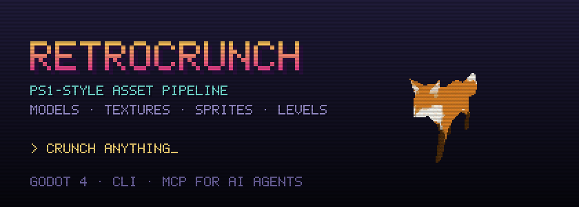
</p>

<p align="center">
  <b>Turn modern models, textures and sprites into PS1-era game assets.</b><br>
  Decimate · palette · dither · wobble · export straight to Godot 4.
</p>

<p align="center">
  
  
  
  
  <a href="LICENSE.md"></a>
</p>

<p align="center">
  <a href="#before-and-after">Before and after</a> ·
  <a href="#features">Features</a> ·
  <a href="#the-ps1-look">The PS1 look</a> ·
  <a href="#quick-start">Quick start</a> ·
  <a href="docs/GUIDE.md">Guide</a> ·
  <a href="#licence">Licence</a>
</p>

---

## Before and after

<p align="center">
  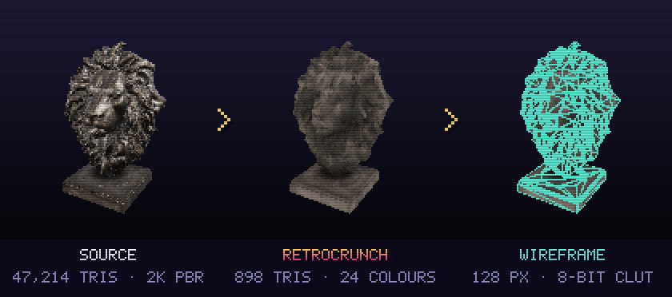
</p>

A 47,214-triangle photoscan in, a 898-triangle model with a 128 px, 24-colour texture out.
Retrocrunch reduces the mesh to your triangle budget, removes faces nobody can see, unwraps
a fresh atlas and rebakes it from the full-resolution source, then crunches the texture to
a 4- or 8-bit colour table. It runs locally: this one took half a second.

## Features

<table>
<tr>
<td width="50%">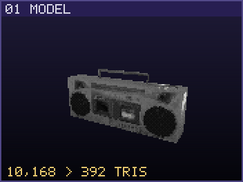<br>
<b>Model.</b> OBJ, glTF/GLB, FBX, and .blend/USD/Alembic through Blender. Triangle budgets,
hidden-face removal, baked AO and sun, and detail focus that keeps faces from flattening.</td>
<td width="50%">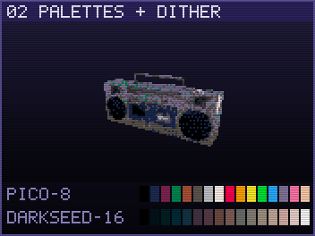<br>
<b>Palettes and dither.</b> Oklab palettes, 10 built-ins, the whole lospec.com library, and
Bayer, PS1-table or Floyd-Steinberg dithering. One shared palette for a whole game.</td>
</tr>
<tr>
<td>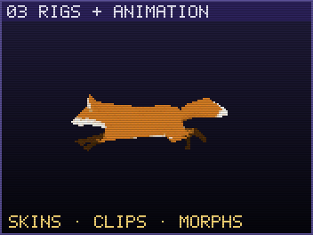<br>
<b>Rigs and animation.</b> Skeletons, skin weights, morph targets and every clip survive
conversion. View the rig, paint weights, and try PS1-style stiff skinning.</td>
<td>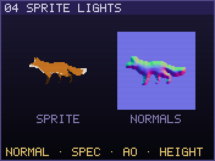<br>
<b>Sprite lights.</b> Normal, specular, occlusion and height maps from 2D sprites, with a
live light preview and a Godot <code>CanvasTexture</code>.</td>
</tr>
<tr>
<td>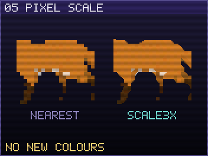<br>
<b>Pixel scale.</b> Scale2x/3x/4x/6x/9x and Eagle: smooth pixel-art upscales that never
invent a colour.</td>
<td>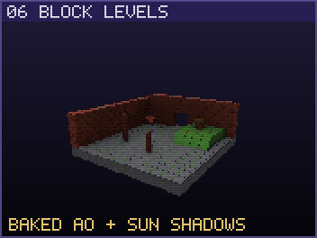<br>
<b>Block levels.</b> Build rooms from cubes, slabs, ramps, corners and pillars. Export a
culled mesh with Godot collision and baked AO and sun shadows.</td>
</tr>
<tr>
<td>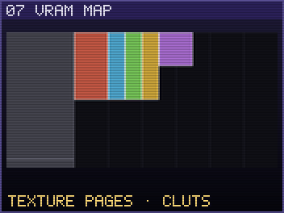<br>
<b>VRAM map.</b> See how your textures and colour tables would pack into the console's
1 MB of video memory, texture page by texture page.</td>
<td>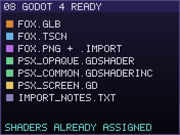<br>
<b>Godot 4 ready.</b> Scenes with the PS1 shaders already assigned, lossless import files,
and an optional 240-line screen pass. Also exports for Unity, Unreal and Blender.</td>
</tr>
</table>

### Sprite sheets for 2.5D billboards

<p align="center">
  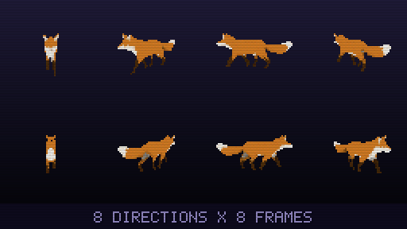
</p>

Render any converted model from 8 directions, animated, into one transparent sheet. The
Godot export comes with an `AnimatedSprite3D` scene and a billboard script that shows the
side facing the camera.

## The PS1 look

Low polygon counts are only half of it. Retrocrunch's viewport and its Godot shaders
reproduce what the hardware did:

- **Vertex jitter**: vertices snap to whole screen pixels.
- **Affine texture warping**: no perspective correction. You choose how much.
- **15-bit colour** with the console's 4x4 dither table.
- **No Z-buffer**: faces sorted the way an ordering table sorts them.
- **Fixed-point wobble**: vertices shift against each other as the camera moves.
- **CRT**: composite blur, scanlines and an aperture grille.
- **240-line screen pass** for Godot: the whole game at PS1 resolution.

## Quick start

**Download a ready-built Windows release from [itch.io](https://laegh.itch.io/retrocrunch)**:
free, or pay what you want to support development. Or build from source with the Rust
MSVC toolchain and the Visual Studio C++ build tools:

```powershell
cargo build --release
.\target\release\retrocrunch.exe                 # the app
.\target\release\retrocrunch.exe model.glb       # the app, with a model open
```

Or convert from the command line:

```powershell
retrocrunch model zombie.fbx -o out --preset "Survival horror character" --engine godot
retrocrunch texture *.png -o out --tex-size 64 --colors 16 --dither ps1
retrocrunch palettes                              # the 10 built-in palettes
```

Every command takes `--json` for a machine-readable report. The [guide](docs/GUIDE.md)
covers every tab and option.

### For AI agents

`retrocrunch mcp` is a Model Context Protocol server. Your coding agent can inspect,
convert, render a preview, look at it, and adjust, all on its own:

```powershell
claude mcp add retrocrunch -- C:\path\to\retrocrunch.exe mcp
```

See [AGENTS.md](AGENTS.md) for the recommended loop.

## Licence

Retrocrunch is **source-available** under the [PolyForm Shield License 1.0.0](LICENSE.md):

- Use it for anything, including making and selling commercial games.
- Read, change and build the source for your own use.
- Everything Retrocrunch outputs is yours, including the shaders and scripts it writes into
  your project. No attribution needed.
- Don't sell or redistribute Retrocrunch, a modified version of it, or a competing product
  based on it.

The `godot/` and `blender/` folders are [MIT No Attribution](godot/LICENSE). Contribution
terms are in [CONTRIBUTING.md](CONTRIBUTING.md). Changes are listed in the
[changelog](CHANGELOG.md).

Third-party crates, fonts and their licences are listed in `THIRD_PARTY_LICENSES.html`;
ship that file with every binary release. To regenerate it after changing dependencies
(needs [cargo-about](https://github.com/EmbarkStudios/cargo-about/releases) 0.9 on the
`PATH`; the prebuilt release is easiest on Windows):

```powershell
cargo about generate about.hbs -o THIRD_PARTY_LICENSES.html
```

## Credits

Every image above was rendered and converted by Retrocrunch itself, from these models:

- [Lion Head](https://polyhaven.com/a/lion_head) by Tina and
  [Boombox](https://polyhaven.com/a/boombox) by Thomas Paul Mouilleron, from Poly Haven
  (CC0).
- Fox: model by [PixelMannen](https://opengameart.org/content/fox-and-shiba) (CC0),
  [rigging and animation](https://sketchfab.com/3d-models/low-poly-fox-by-pixelmannen-animated-371dea88d7e04a76af5763f2a36866bc)
  by tomkranis, glTF conversion by AsoboStudio and scurest, under
  [CC BY 4.0](https://creativecommons.org/licenses/by/4.0/). Converted, posed and rendered
  for these images.

The built-in palettes are credited to their authors in the app's palette library.

PlayStation and PSX are trademarks of Sony Interactive Entertainment. Retrocrunch is not
affiliated with or endorsed by Sony.
